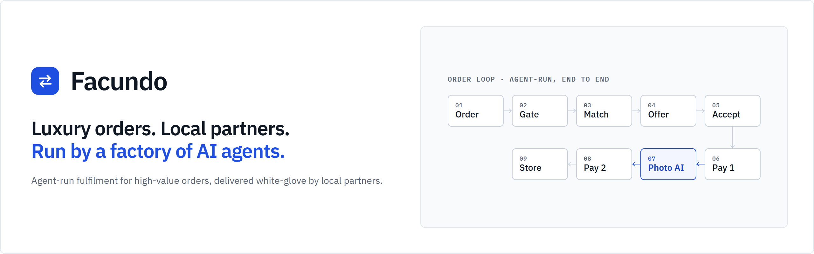
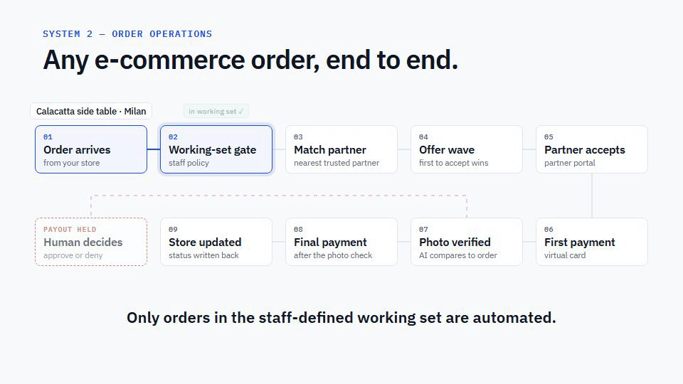
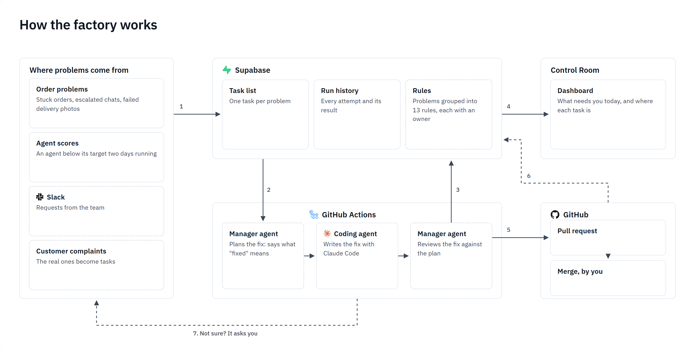
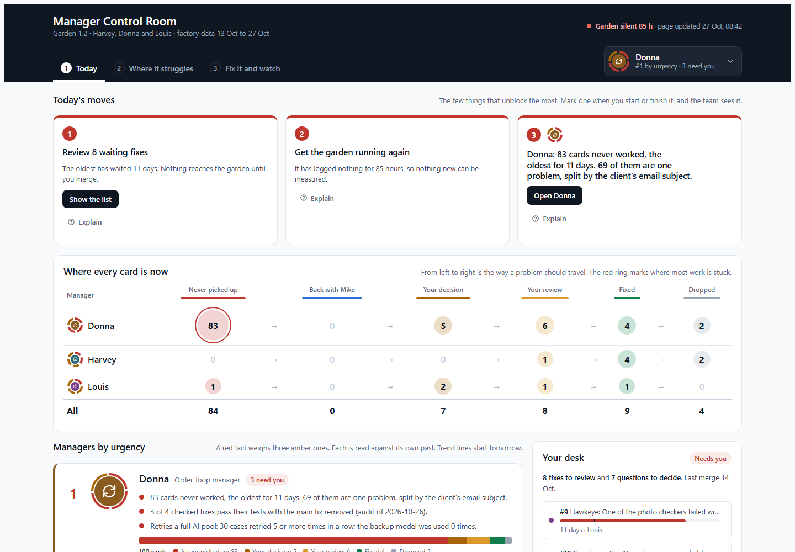

<div align="center">



**AI agents deliver high-value orders through local partners. When an order still needs a person, the system treats that as a bug and fixes itself.**

[How it works](#how-it-works) · [How it fixes itself](#how-it-fixes-itself) · [Three decisions](#three-decisions) · [Run it locally](#run-it-locally) · [Sources](#sources)

</div>

---

## How it works

Two products share one codebase. The goal of both is one number: **fewer orders that need a human.**

| | What it does |
|---|---|
| **Scout** | Finds every potential partner in a city, fills in their details with AI, ranks them on a live map, and reaches out by email and SMS until they sign up. |
| **Order engine** | Takes each order from the store, offers it to the best nearby partner, pays in two parts on a virtual card, checks the delivery photo with AI, and updates the store. Only the exceptions reach a person. |

<a href="https://javoo-bot.github.io/facundo/#overview"></a>

Every step is a setting, not hard-coded. Every way an order can break, and how it is handled, is one file: [`dashboard/lib/lifecycle.ts`](dashboard/lib/lifecycle.ts), 113 situations under 16 steps.

## How it fixes itself



1. The 113 situations are grouped under **13 rules**, each with an owner: a manager agent for supply, one for the order loop, one for delivery proof, and the human for money.
2. Every 30 minutes a sweep reads the garden (about 400 simulated orders a day) and places each failure on its rule. An exact match is free; otherwise a small model picks the nearest rule, capped at $0.50 a day.
3. A rule with **3 alerts in 7 days** opens one task. The owning manager writes what "fixed" means, a coding agent writes the fix as a draft PR, and the same manager checks it against its own brief. Nobody grades their own work.
4. The task closes only when the rule stays **quiet for 7 days** after the merge. A new alert reopens the same task.
5. The human decides money and merges, from one page.



That page is the [Control Room](docs/agent-factory/garden-1.2/part-4/), shown here with demo data. It shows numbers, never verdicts, and compares each manager only with its own past. Two more pages behind it: the [rule map](docs/agent-factory/garden-1.2/) (every rule with the alerts and tasks it caused) and [trouble paths](docs/agent-factory/garden-1.2/part-2/) (the steps an agent takes once something goes wrong, drawn from its event log).

## Three decisions

**A fix is done when the problem stops, not when its tests pass.** When we checked the agents' fixes, four of six still passed their tests with the fix itself taken out. So every fix is now checked that way, and a task closes only once its problem has stayed away for a week.

**One switch decides which orders the agents may touch.** Everything else can only look. It exists because automation once reached orders nobody had meant to include.

**Money, logins and messages to customers always wait for a person.** An agent can propose a change there, but the proposal is marked "Needs a person" and stops. A partner used for testing can never receive a real payment.

## Run it locally

**You need** Node 20+, Docker Desktop running, and the [Supabase CLI](https://supabase.com/docs/guides/local-development/cli/getting-started). No paid API keys: each integration switches itself off when its key is missing. The first run downloads about 2 GB of Docker images.

```bash
git clone https://github.com/Javoo-bot/facundo.git && cd facundo
./scripts/local-setup.sh          # local database, schema, demo partners and orders, demo login
cd dashboard && npm install && npm run dev    # http://localhost:3001
```

Sign in with `demo@example.com` / `demo-password`. Tests:

```bash
cd dashboard     && npx tsc --noEmit && npm test
cd ingest-worker && npm run typecheck && npm test
node --test "agents/factory/**/*.test.mjs"
```

Observability walkthroughs (PostHog, Grafana, Langfuse) are on the [project page](https://javoo-bot.github.io/facundo/).

## Limitations

- The public copy runs on demo data and a simulated garden. The store, card and messaging integrations are real code behind switches, not exercised here.
- The manager agents, rule tasks and 7-day close shipped on 27 Oct 2026. The nearest-rule grouping has not yet been checked against a set of tasks labelled by a person.
- The "fix removed" audit is run by hand after each batch of fixes, not on every PR.

## Sources

Ideas this repo took, and where each one went.

| From | Taken |
|---|---|
| Lauren Tan, [*How I shipped 2,500 PRs last month*](https://x.com/poteto/status/2102050467505430555) | The bottleneck is verification, not more agents: make one agent trustworthy, then multiply. Reports from Slack become agent work. The whole factory loop. |
| Meta, [*LLM-powered bug catchers (ACH)*](https://engineering.fb.com/2025/02/05/security/revolutionizing-software-testing-llm-powered-bug-catchers-meta-ach/) | A test only counts if it fails on a broken copy. Our "main fix removed" audit. |
| Anthropic, [*Demystifying evals for AI agents*](https://www.anthropic.com/research/demystifying-evals-for-ai-agents) | A check needs a known-good answer that must pass; repeated runs count, not one lucky pass. |
| Hamel Husain, [*Error analysis*](https://hamel.dev/blog/posts/evals-faq/why-is-error-analysis-so-important-in-llm-evals-and-how-is-it-performed.html) | A person reads real runs first, groups the failures, counts them; tests come after. The topic notes and the test audit. |
| Cognition, [*Don't build multi-agents*](https://cognition.ai/blog/dont-build-multi-agents) | A worker that only gets a summary misses the decisions upstream. One coding agent; the manager keeps the judgment. |
| Anthropic, [*Multi-agent research system*](https://www.anthropic.com/engineering/built-multi-agent-research-system) | The lead writes the brief and checks the result. The manager brief and check. |
| Sentry, [*Event grouping*](https://docs.sentry.io/concepts/data-management/event-grouping/) | Fingerprint first, model fallback, err on keeping cases apart. Exact match, then near match. |
| Raindrop, via [ZenML](https://www.zenml.io/llmops-database/production-monitoring-and-issue-discovery-for-ai-agents) | Count the signals an agent never reports: gave up quietly, held without a reason. The Control Room's four yes/no signals. |

## Repository map

| Folder | What's inside |
|---|---|
| [`dashboard/`](dashboard/) | The web app: back office, human desk, partner portal, Scout map, `lifecycle.ts` |
| [`ingest-worker/`](ingest-worker/) | The order engine: intake, matching, offers, reconciliation (Cloudflare Worker) |
| [`ingest/`](ingest/) | Scout: scrape, enrich and score partners per city (Python) |
| [`agents/`](agents/) | The agents, the factory, the daily simulation, the Grafana dashboards |
| [`docs/agent-factory/`](docs/agent-factory/) | The factory's design notes, the Control Room, rule map and trouble paths |
| [`docs/superpowers/specs/`](docs/superpowers/specs/) | One design doc per feature |

[`CLAUDE.md`](CLAUDE.md) is the working brief for an AI pair on this repo; [`AGENTS.md`](AGENTS.md) points a coding agent at it.

---

<div align="center">

**Built by Javier Lobato** · [LinkedIn](https://www.linkedin.com/in/javier-lobato-menendez) · [GitHub](https://github.com/Javoo-bot)

</div>
