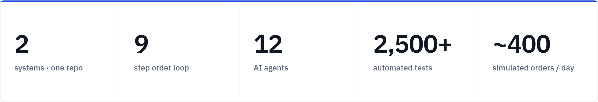
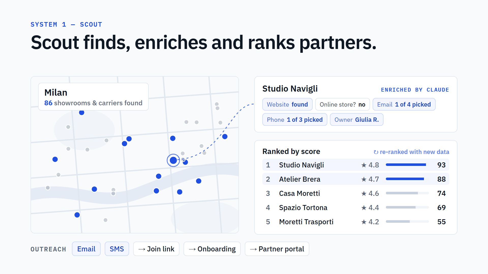
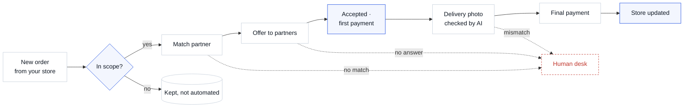
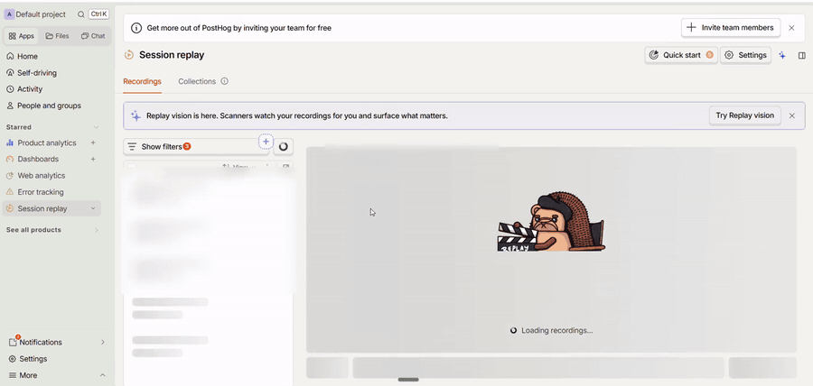
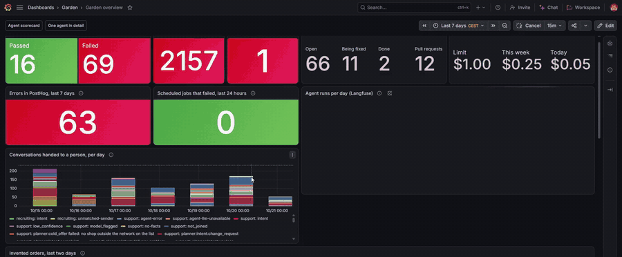
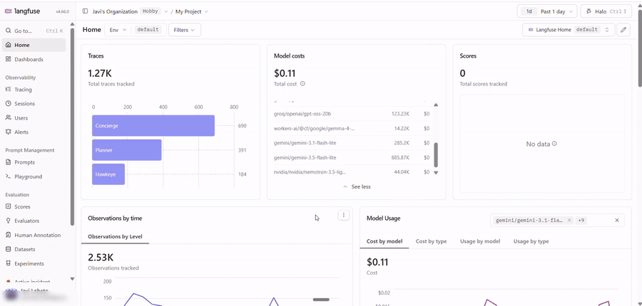

<div align="center">


<br>


**[Watch the video](#one-minute-overview)** · **[How it works](#how-it-works)** · **[Tech stack](#tech-stack)** · **[Engineering](#engineering-highlights)** · **[Observability](#observability)** · **[Run it locally](#run-it-locally)**

</div>

---

### In one sentence

**AI agents deliver high-value orders through local partners: they find the right partner, pay them, check the delivery, and only call a person when something's off.**

### Why it stands out

- **Built for real operations, not a demo.** It takes orders from an e-commerce store, pays real partners on virtual cards, and is rehearsed every day on hundreds of simulated orders.
- **Two products in one codebase.** A growth engine that finds and signs up delivery partners, and an operations engine that routes orders through them.
- **A factory of AI agents.** A dozen specialised Claude-based agents, each with its own job, budget and quality bar.
- **Built like production software.** More than 2,500 automated tests, CI/CD, row-level security, and full observability in PostHog, Grafana and Langfuse.



---

## One-minute overview

<a href="https://javoo-bot.github.io/facundo/#overview"></a>

<p align="center"><a href="https://javoo-bot.github.io/facundo/#overview"><b>▶ Watch the full one-minute video</b></a></p>

<sub>The video is made entirely in code with <a href="https://www.remotion.dev/">Remotion</a> and its official Claude Code agent skills: React compositions rendered to MP4, with no screen recording and no editing software.</sub>

---

## How it works

Two systems, one repo:

| | What it does |
|---|---|
| **Scout** | Finds every potential partner in a city, uses AI to fill in their details, ranks them on a live map, and reaches out by email and SMS until they sign up. |
| **Order engine** | Takes each new order from your store, offers it to the best nearby partner, pays them in two parts, checks the delivery photo with AI, and updates the store. |



### The order loop



Each step is a setting, not hard-coded: which orders are in scope, how far to look for partners, how long an offer waits, how payments are split and when a photo needs a person. Every way the loop can fail, and how it's handled, is mapped in [`dashboard/lib/lifecycle.ts`](dashboard/lib/lifecycle.ts).

---

## Tech stack

| Layer | Choice |
|---|---|
| Web app | Next.js 15 (App Router), React 19, TypeScript |
| Order engine | Cloudflare Workers, Workflows, Queues, cron |
| Data & auth | Supabase Postgres with row-level security |
| AI | Claude Sonnet + Haiku via OpenRouter, Gemini for photo votes |
| Partner search | Python 3.11, Playwright, Apify |
| Integrations | E-commerce platforms (e.g. WooCommerce, BigCommerce), any email API (e.g. Resend), SMS API (e.g. Twilio), virtual cards (e.g. Stripe Issuing) |
| Operations | GitHub Actions, Trigger.dev, PostHog, Grafana, Langfuse |

---

## Engineering highlights

- **One gate for all automation.** A single `isInWorkingSet()` check decides which orders the agents may touch. A test fails if its two copies drift apart.
- **LLMs as typed functions.** Every Claude call returns a schema-validated object, not free text ([`llm.ts`](ingest-worker/src/llm.ts)).
- **Cost-aware model routing.** Moving three extraction tasks from Sonnet to Haiku cut AI cost by about 40%, with no drop in quality ([`usage.py`](ingest/usage.py)).
- **Safe payments.** Two-part payouts on virtual cards. Test partners can never receive a real card ([`payoutMath.ts`](dashboard/lib/payoutMath.ts)).
- **Multi-model photo checks.** Two models vote on every delivery photo, and two more run in shadow mode for evaluation ([`photoVerify/`](dashboard/lib/photoVerify/)).
- **One queue for "needs a human".** Every escalation lands in one prioritised list ([`cxAttention.ts`](dashboard/lib/cxAttention.ts)).
- **Security in the database.** Postgres row-level security, so the public key alone can't read anything.
- **An agent factory.** Each agent is one file ([`agents/thinking/`](agents/thinking/)). A missed quality bar becomes a task card and a draft pull request ([`agents/factory/`](agents/factory/)).
- **Agent monitoring.** Managers own the rules, an engineer agent fixes, and three pages show where they get stuck: a rule map, trouble paths and a control room ([`docs/agent-factory/garden-1.2/`](docs/agent-factory/garden-1.2/)).
- **Tested end to end.** 2,500+ tests, including a [full order-loop test](ingest-worker/test/e2e/orderLoop.e2e.test.ts) against an in-memory database.

---

## Observability

The live dashboards sit behind a login, so here are short recorded walkthroughs. Click any preview for the full video.

<table>
<tr>
<td width="33%" valign="top">

**PostHog**<br>
<sub>Product analytics and session replay of the back office</sub>

<a href="https://javoo-bot.github.io/facundo/#posthog"></a>

<sub><a href="https://javoo-bot.github.io/facundo/#posthog">▶ Full walkthrough · 47 s</a></sub>

</td>
<td width="33%" valign="top">

**Grafana**<br>
<sub>Agent scorecards and orders that need a person</sub>

<a href="https://javoo-bot.github.io/facundo/#grafana"></a>

<sub><a href="https://javoo-bot.github.io/facundo/#grafana">▶ Full walkthrough · 36 s</a></sub>

</td>
<td width="33%" valign="top">

**Langfuse**<br>
<sub>LLM traces, cost and latency per model</sub>

<a href="https://javoo-bot.github.io/facundo/#langfuse"></a>

<sub><a href="https://javoo-bot.github.io/facundo/#langfuse">▶ Full walkthrough · 22 s</a></sub>

</td>
</tr>
</table>

Order-automation failures (`order_automation_failed`, `order_match_failed`, `order_workflow_step_failed`) reach PostHog through a single `captureError()` entry point. The Grafana dashboards are versioned as JSON in [`agents/monitoring/dashboards/`](agents/monitoring/dashboards/).

---

## Run it locally

**You need:** Node 20+, Docker Desktop (running), and the [Supabase CLI](https://supabase.com/docs/guides/local-development/cli/getting-started). On Windows, use Git Bash. You don't need any paid API keys to explore the dashboard, because each external integration switches itself off when its key is missing.

The first run downloads about 2 GB of Docker images, so allow 5–25 minutes. After that, a re-run resets the database in about 2 minutes.

```bash
git clone https://github.com/Javoo-bot/facundo.git
cd facundo

# 1. Local database: starts Supabase in Docker, applies the schema and
#    migrations, loads demo partners and orders, and creates a demo login
./scripts/local-setup.sh

# 2. Dashboard
cd dashboard
npm install
npm run dev        # http://localhost:3001
```

Sign in with **`demo@example.com`** / **`demo-password`**. You'll land in the back office with 12 demo orders and 13 demo partners. Emails are logged instead of sent, and demo product photos show as placeholders. Run `supabase stop` when you're done.

<details>
<summary><b>The other two parts (optional)</b></summary>

<br>

```bash
# Order engine (Cloudflare Worker): tests only, no account needed
cd ingest-worker && npm install && npm run typecheck && npm test

# Scout: partner search for one city (needs APIFY_TOKEN and OPENROUTER_API_KEY in ingest/.env)
cd ingest && uv sync && uv run playwright install chromium
uv run python main.py --country ES --city Valencia --limit 50
```

Each package has an `.env.example` or `.dev.vars.example` listing every variable and what happens when it's unset.

</details>

**Run the tests**

```bash
cd dashboard     && npx tsc --noEmit && npm test
cd ingest-worker && npm run typecheck && npm test
```

---

## Repository map

| Folder | What's inside |
|---|---|
| [`dashboard/`](dashboard/) | The web app: back office, human desk, partner portal, Scout map |
| [`ingest-worker/`](ingest-worker/) | The order engine: intake, matching, offers, reconciliation |
| [`ingest/`](ingest/) | Scout's partner search: scrape, enrich and score per city |
| [`agents/`](agents/) | The AI agents, daily simulation, factory and Grafana dashboards |
| [`supabase/`](supabase/) | Database schema, 120+ migrations and demo data |
| [`docs/superpowers/specs/`](docs/superpowers/specs/) | One design doc per feature |
| [`.github/`](.github/) | CI and deploy pipelines |

[`CLAUDE.md`](CLAUDE.md) is the working brief for AI pair-programming on this repo, and the shortest explanation of how everything fits together.

---

<div align="center">

**Built by Javier Lobato**

I design and build AI-native systems end to end, working with Claude Code as a daily pair: design doc first, then tests, then code.

[LinkedIn](https://www.linkedin.com/in/javier-lobato-menendez) · [GitHub](https://github.com/Javoo-bot)

</div>
