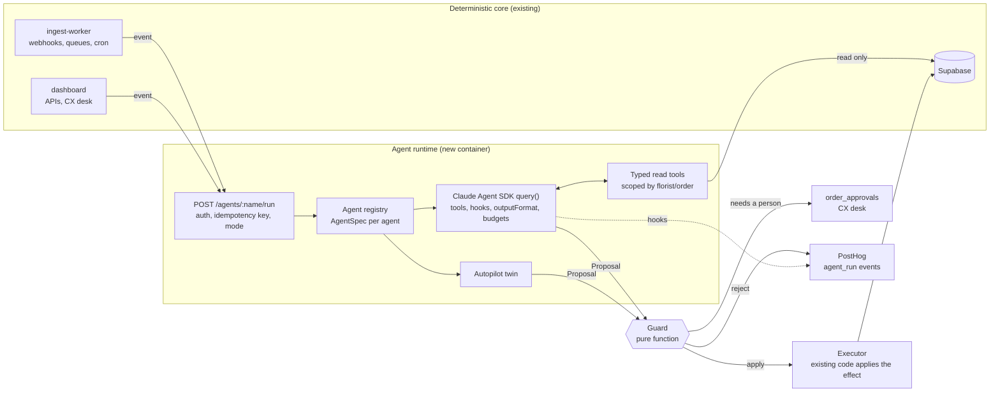

# Agent runtime: growing the AI part without losing determinism

Status: draft for discussion. Experiment lives in `dev_cx` on branch
`experiment/agent-runtime`, running on personal accounts, not company resources.

## The question

Facundo today has three planes:

1. **Deterministic core.** Matching, offer waves, payouts, Shopify write-back,
   working-set gate. Same input, same result.
2. **AI steps.** Six single model calls (relevance, enrichment picks,
   recruiting copy, reply drafts, recipe translation, photo check). Each is
   wrapped by a fixed rule.
3. **Humans.** The CX desk, approvals in semi mode, phone calls.

We want the AI plane to take on more work (look things up, reason over several
steps, handle more cases) while the system as a whole stays predictable enough
to run real orders and real money.

## The thesis

A model's output is never deterministic. The **envelope** around it can be:

- what it is allowed to read (a closed set of typed tools, scoped to one florist
  or one order),
- what shape it must answer in (a schema, validated by code),
- what may happen as a result (a closed set of effects, executed only by
  existing deterministic code after a pure guard approves),
- what happens when it fails (a deterministic twin that serves the same
  contract),
- how we know it is still good (evals that gate every promotion).

If those five are code, the agent can grow in capability without the system
growing in unpredictability. Same proposal, same decision, every time. That is
the property we keep.

## What we already do right, and the gaps

Already right, and worth keeping as the pattern:

- `cxAgentGuard.ts` decides send or escalate in pure, tested code, independent
  of the model's opinion of itself.
- Every AI step has a fallback (template, English, keep the place, human).
- Photo verification already runs extra models in **shadow mode** and records
  them without letting them vote.

Gaps found while tracing (2026-10-09):

- The reply agent reads the **oldest** 10 messages, not the latest
  (`dashboard/lib/agentTurn.ts:147`).
- A thread already `awaiting_human` can still be auto-answered. Nothing in the
  turn checks status.
- Facts are preloaded once per turn, so they can be stale, and the model cannot
  ask for anything that was not preloaded.
- Several rules live only in prompts ("never invent an owner name", "keep the
  70/30 split") with no code check.
- The two voting photo models have no timeout.
- Each AI step is wired differently. There is no shared contract, no shared
  telemetry event, no shared mode switch.

## What race-condition teaches (Google ADK reference app)

Read from `race-condition-main` on 2026-10-09. The framework is ADK, the lessons
are not.

| Pattern there | How it is done | Our port |
|---|---|---|
| Deterministic twin | `runner_autopilot` reuses the LLM runner, short-circuits the model in a `before_model_callback`, and emits the same tool calls. Parity tests keep both in step. | Every agent ships an `autopilot` that returns the same output type. Used for CI, outages and kill switches. |
| Policy in code, not prompt | Secure vs insecure financial skills differ only in text, so the secure mode is also enforced by a pre-model callback. | Guards are pure functions plus SDK `PreToolUse` hooks. A prompt rule with no code check is a bug. |
| IDs across the LLM boundary | Large payloads live in session state or Redis. The model passes IDs only. A regression test documents the corruption this prevents. | Tools take `orderId`, `threadId`. The model never copies addresses, amounts or line items into tool arguments. |
| Idempotent side effects | Per-invocation guards, `SET NX EX` locks, seeded randomness. | Every run has an idempotency key from the triggering event. Effects are applied by existing CAS-style code. |
| At-least-once delivery, dedupe everywhere | Events arrive twice on purpose (Redis plus HTTP), deduped by event id and per-session lock. | The core may retry a call to the runtime. The runtime dedupes on the key. |
| Structured tool errors | Tools return `{status: "error", message}` telling the model how to recover. | Same. Exceptions are for real faults only. |
| Quality gate as a score | Weighted criteria, threshold 75, severity veto, labelled heuristic fallback. | Eval scorers and the promotion ladder below. |
| Two kinds of evals | Fast dataset and prompt-contract tests in CI. Slow live-model trajectory evals on demand. | Same split. |
| One telemetry plugin | Every lifecycle event stamped with session, invocation, sequence and business IDs. | One SDK hook set that emits PostHog events for every agent. |
| Fault-injection variants | `simulator_with_failure` swaps one tool to prove graceful degradation. | A fault test per agent: tool throws, model times out, budget exceeded. |
| Skills as folders | `SKILL.md` plus `tools.py`. A compliance test blocks merge on bad descriptions. | Agent folders with the same shape. A lint test on every spec. |

## Why the Claude Agent SDK, and where not to use it

The Agent SDK gives us, verified against the docs on 2026-10-09:

- `outputFormat: { type: "json_schema", schema }` with validation and re-prompt.
  The result arrives as `structured_output`. Failure is the subtype
  `error_max_structured_output_retries`.
- Typed in-process tools: `tool(name, description, zodShape, handler)` and
  `createSdkMcpServer`.
- `tools`, `allowedTools`, `disallowedTools` to close the tool set.
- Hooks (`PreToolUse` can deny or rewrite, `PostToolUse` can audit or replace
  output, `Stop`, `SubagentStop`). A single `deny` from any hook wins.
- `canUseTool` for a human-approval gate.
- `maxTurns`, `maxBudgetUsd`, `abortController` for bounds.
- `settingSources: []` and `CLAUDE_CODE_DISABLE_AUTO_MEMORY=1` so nothing leaks
  in from the filesystem.
- Subagents via the `agents` option, each with its own tools, model and
  `maxTurns`.

Its cost: **it spawns a `claude` subprocess.** It needs a container (Node 18+,
about 1 GiB RAM per concurrent session). It cannot run inside the Cloudflare
Worker or a Vercel function. So it becomes a new service.

Rule: **use the SDK only where the model must use tools over several turns.**
A single classification or comparison stays a plain Messages API call with
forced tool output, as today. Concretely:

| Step | Needs tools over turns? | Runtime |
|---|---|---|
| Florist support replies | Yes: look up order, payout, help, thread | Agent SDK |
| Enrichment research | Yes: fetch pages, follow links, verify | Agent SDK |
| CX desk triage (new) | Yes: read the attention item and the order history | Agent SDK |
| Florist relevance | No | Messages API |
| Photo check | No | Messages API |
| Recipe translation | No | Messages API |

## Target architecture



Three rules hold the shape together:

1. **Agents propose, code disposes.** The runtime returns a typed `Proposal`.
   It never writes to Supabase, sends a message or moves money.
2. **The guard is pure and lives in the core.** It takes the input, the
   proposal and the evidence, and returns `apply`, `approve` or `reject`. It is
   unit-tested like `cxAgentGuard.ts` is today.
3. **Orchestration stays deterministic.** The worker and the dashboard decide
   when an agent runs. Agents do not call other agents in production. Subagents
   are allowed only inside one run, for parallel reading, and never for effects.

## The contract

Usage first. Defining the florist support agent:

```ts
export const floristSupport = defineAgent({
  name: "florist-support",
  input: SupportTurnInput,          // zod: { threadId, floristId, orderId, messageId }
  output: SupportProposal,          // zod: { intent, reply, factsUsed[], confidence }
  tools: [getOrderFacts, getPayoutStatus, getRecentMessages, searchPublishedHelp],
  model: "claude-sonnet-5",
  maxTurns: 6,
  maxBudgetUsd: 0.05,
  guard: supportGuard,              // (input, proposal, evidence) => Decision
  autopilot: supportAutopilot,      // same input, same SupportProposal, no model
  evals: "agents/florist-support/evals",
});
```

Calling it from the core:

```ts
const run = await agents.run("florist-support", input, {
  idempotencyKey: `msg:${messageId}`,
});
switch (run.decision.kind) {
  case "apply":   await sendSupportReply(run.proposal); break;
  case "approve": await fileApproval("support_reply", run); break;
  case "reject":  await escalateThread(input.threadId, run.decision.reason); break;
}
```

Types the sketch implies:

```ts
type Mode = "off" | "shadow" | "draft" | "auto";

type Decision =
  | { kind: "apply" }
  | { kind: "approve"; reason: string }
  | { kind: "reject"; reason: string };

interface AgentSpec<I, P> {
  name: string;
  input: z.ZodType<I>;
  output: z.ZodType<P>;
  tools: AgentTool[];               // read-only, scoped by input ids
  model: string;
  maxTurns: number;
  maxBudgetUsd: number;
  guard: (input: I, proposal: P, evidence: Evidence) => Decision;
  autopilot: (input: I) => Promise<P>;
  evals: string;
}

interface AgentRun<P> {
  runId: string;
  agent: string;
  mode: Mode;
  source: "model" | "autopilot";
  proposal: P;
  evidence: Evidence;               // every tool call and its result, by id
  decision: Decision;
  costUsd: number;
  turns: number;
}

declare function defineAgent<I, P>(spec: AgentSpec<I, P>): AgentSpec<I, P>;
declare function run<I, P>(name: string, input: I, opts: { idempotencyKey: string }): Promise<AgentRun<P>>;
```

What `run` does, in order:

1. Dedupe on `idempotencyKey`. A repeat returns the stored `AgentRun`.
2. Read the agent's mode from `app_settings`. `off` runs the autopilot only.
3. Validate the input with zod. Bad input is a reject, not a model call.
4. Call `query()` with `tools` set to the agent's MCP server only,
   `settingSources: []`, `outputFormat` from the output schema, `maxTurns`,
   `maxBudgetUsd`, and a deadline via `abortController`.
5. A `PreToolUse` hook checks every tool call against the scope in the input,
   so a support run for florist A cannot read florist B. A `PostToolUse` hook
   records the evidence.
6. Parse `structured_output` with the zod schema. Any failure falls back to the
   autopilot and marks `source: "autopilot"`.
7. Run the guard. In `shadow`, also run the autopilot and record both. Only the
   autopilot's result is used.
8. Emit one `agent_run` PostHog event with run id, agent, mode, source,
   decision, cost, turns and business ids.

## Evidence-carrying outputs

The strongest determinism tool we have: **make the model cite, then check the
citation in code.**

- The enrichment researcher returns an email **and** the URL and text snippet
  it came from. The guard re-fetches nothing. It checks the snippet appears in
  the page the tool already fetched and recorded as evidence. No match, no
  write.
- The support agent returns `factsUsed` as tool-result ids. The guard checks
  every amount and date in the reply appears in one of those results. This
  replaces today's regex backstop with an exact check.
- The recruiting copy returns which approved sentences it kept. The guard checks
  the 70/30 split and the join link are present verbatim.

## Modes and the promotion ladder

Each agent has a mode in `app_settings.agent_modes`, switchable without deploy.

| Mode | Model runs | Who acts |
|---|---|---|
| `off` | No | Autopilot or today's code path |
| `shadow` | Yes, recorded | Autopilot. Model output only compared |
| `draft` | Yes | A person approves every proposal on the CX desk |
| `auto` | Yes | Guard decides. Humans see only `approve` cases |

Promotion is a measured step, never a feeling:

- `shadow → draft`: on the golden set, schema pass rate at least 99% and guard
  agreement with the human label at least 90%.
- `draft → auto`: two weeks of drafts where CX sent at least 95% unedited, and
  zero high-severity misses (a complaint or opt-out that was not escalated).
- Any high-severity miss in `auto` drops the agent back to `draft`
  automatically.

## Evals

Two layers, same split as race-condition:

- **Fast, in CI, no model.** Zod schemas round-trip. Guard unit tests on fixed
  proposals. Autopilot integration tests through the real `run` pipeline.
  Prompt contract tests (the prompt still says the things the guard relies on).
  Spec lint (every agent has a guard, an autopilot, an evals folder, a budget).
- **Slow, on demand.** Golden sets built from our own history: past support
  threads with the CX outcome, past photo verdicts with the human call,
  enrichment notes with known-good contacts. A scorer with weighted criteria, a
  threshold and a severity veto. Results stored per model and prompt version.

## What to build in the experiment, in order

1. **Runtime skeleton.** One container, `POST /agents/:name/run`, registry,
   `run` pipeline, hooks, PostHog event. One trivial agent to prove the wiring.
2. **Florist support agent** in `shadow`. Tools replace preloaded facts, which
   removes the oldest-10 and stale-facts bugs by construction. The guard is
   today's `cxAgentGuard` plus evidence checks.
3. **Golden set and scorer** for support, from staging-like data.
4. **Enrichment researcher** with evidence-carrying output, in `shadow` next to
   today's crawler.
5. **CX desk triage**: proposes the next action from the closed set that
   `lib/operator.ts` already computes. Always `draft`.

Not in the experiment: moving money, Shopify writes, anything that sends to a
real florist or customer.

## Running it on personal accounts

- Fresh Supabase project: `supabase/schema.sql`, then the migrations in date
  order. Test shops only.
- Personal `ANTHROPIC_API_KEY`. The SDK talks to the Anthropic API. Today's
  OpenRouter calls stay as they are for the non-SDK steps, or move to the same
  key.
- `test_mode` on, `payments_live` off, Shopify write-back off, Ongage and
  Telnyx unset. Every send goes to `test_email`.
- The runtime container on a personal host (Fly.io, Railway, Cloud Run or
  Modal). One region, scale to zero between runs, because every run is a
  one-shot `query()`.
- No `.env` was copied from the company checkout. Only the `.example` files
  exist.

## Open questions for discussion

1. **Where does conversation state live?** This design keeps it in Supabase and
   passes ids, so SDK sessions are one-shot and disposable. The alternative is
   SDK `resume` with a `SessionStore`. Ours is simpler and keeps one source of
   truth. Agree?
2. **TypeScript or Python for the runtime?** TypeScript reuses the dashboard's
   zod schemas and guards directly. Python matches `ingest/`. I lean
   TypeScript.
3. **Host.** Any preference among Fly.io, Railway, Cloud Run, Modal?
4. **First agent.** Support is the most valuable and has known bugs to fix.
   Enrichment is the safest (no human on the other end). Which first?
5. **Budget per run.** Proposed $0.05 for support and $0.20 for enrichment.
   Reasonable?
